# Pokemon Silver public graphics

This page is generated from the repository's verified `graphics/` tree. Japanese and Korean assets are listed before English and other official languages.

## Font

| Preview | File | Language | Size | SHA-256 |
| --- | --- | --- | --- | --- |
|  | [`graphics/font/main-font-jp.png`](graphics/font/main-font-jp.png) | Japanese | 512x256 | `924a7bb2dd14aab6...` |
| 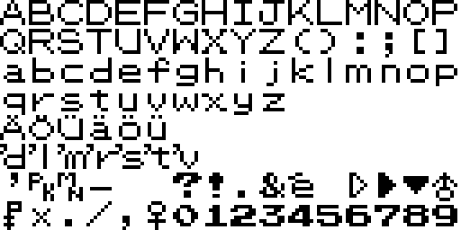 | [`graphics/font/main-font-en.png`](graphics/font/main-font-en.png) | English | 512x256 | `f62d30328111d9c0...` |
|  | [`graphics/font/main-font-de.png`](graphics/font/main-font-de.png) | German | 512x256 | `9d2ddb8b661d41b7...` |
| 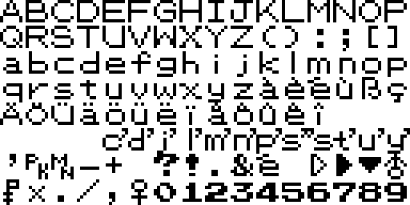 | [`graphics/font/main-font-fr.png`](graphics/font/main-font-fr.png) | French | 512x256 | `9d2ddb8b661d41b7...` |
| 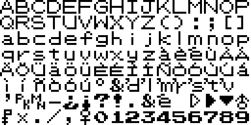 | [`graphics/font/main-font-it.png`](graphics/font/main-font-it.png) | Italian | 512x256 | `7edc3aa24a068598...` |
|  | [`graphics/font/main-font-es.png`](graphics/font/main-font-es.png) | Spanish | 512x256 | `7edc3aa24a068598...` |
| 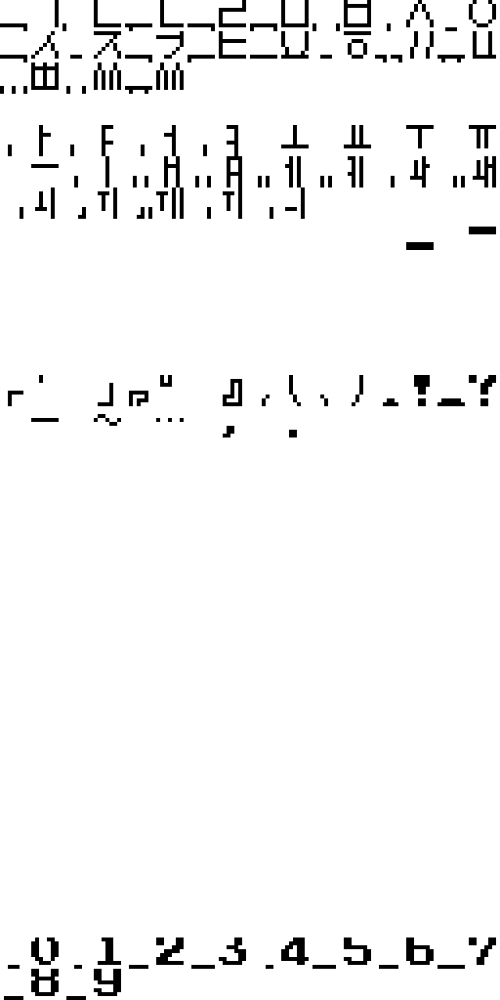 | [`graphics/font/hangul/table-0.png`](graphics/font/hangul/table-0.png) | Unspecified | 512x1024 | `016c9e6fee49d648...` |
|  | [`graphics/font/hangul/table-1.png`](graphics/font/hangul/table-1.png) | Unspecified | 512x1024 | `1bf5d7772b3ea93d...` |
|  | [`graphics/font/hangul/table-2.png`](graphics/font/hangul/table-2.png) | Unspecified | 512x1024 | `941d97811a474fe9...` |
| 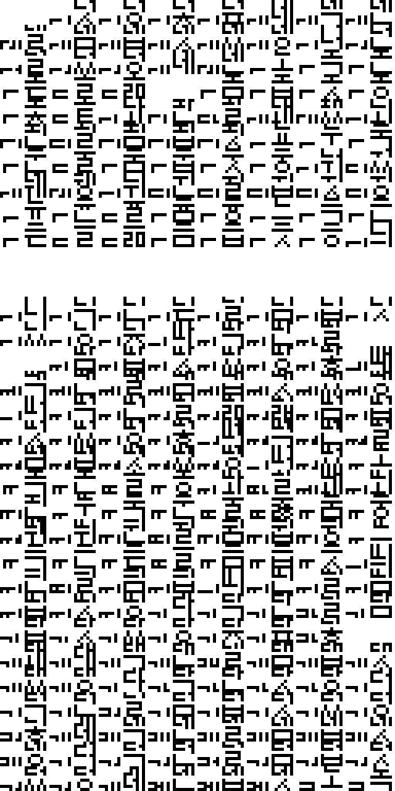 | [`graphics/font/hangul/table-3.png`](graphics/font/hangul/table-3.png) | Unspecified | 512x1024 | `79fa31c822708e32...` |
| 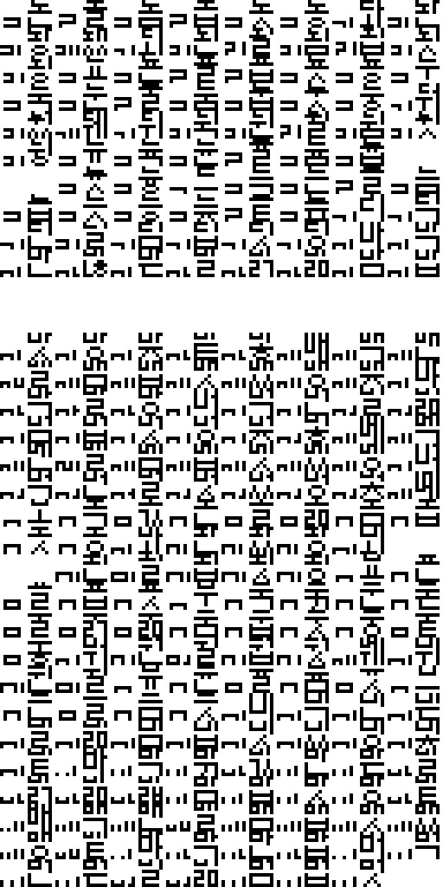 | [`graphics/font/hangul/table-4.png`](graphics/font/hangul/table-4.png) | Unspecified | 512x1024 | `9567075b9c361724...` |
| 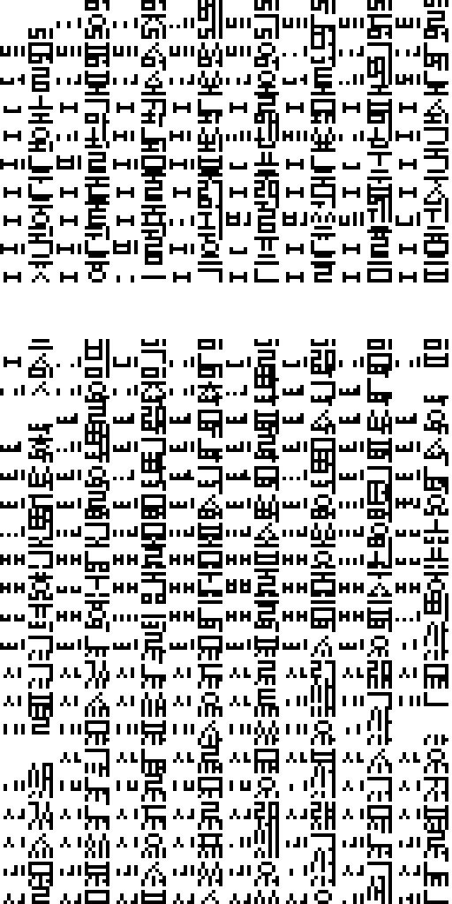 | [`graphics/font/hangul/table-5.png`](graphics/font/hangul/table-5.png) | Unspecified | 512x1024 | `0290325b2ffb3c1d...` |
| 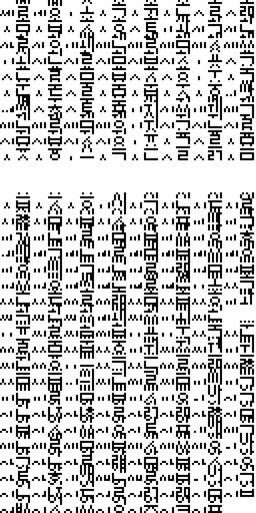 | [`graphics/font/hangul/table-6.png`](graphics/font/hangul/table-6.png) | Unspecified | 512x1024 | `61a84480f4b3219f...` |
| 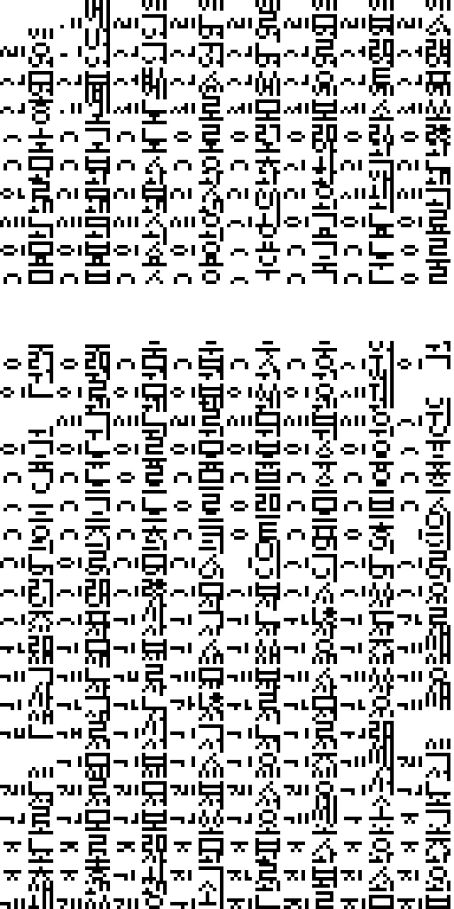 | [`graphics/font/hangul/table-7.png`](graphics/font/hangul/table-7.png) | Unspecified | 512x1024 | `74eca84b5fd736d7...` |
| 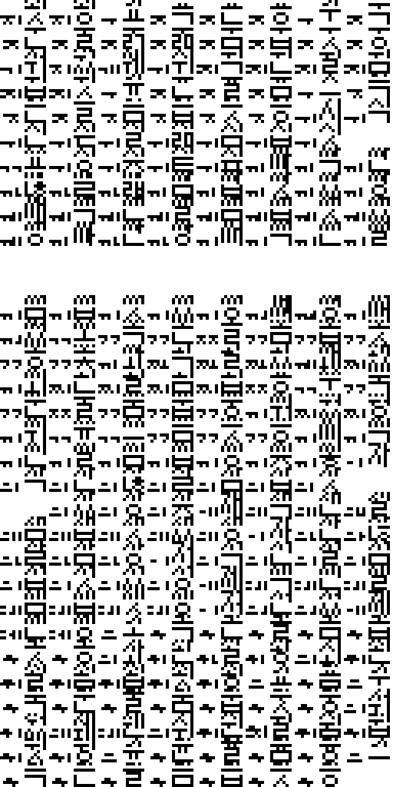 | [`graphics/font/hangul/table-8.png`](graphics/font/hangul/table-8.png) | Unspecified | 512x1024 | `fe30cb27b1b04dae...` |
| 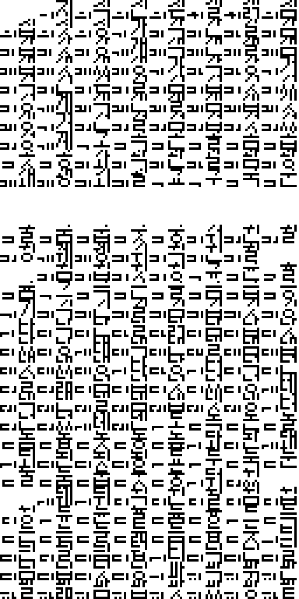 | [`graphics/font/hangul/table-9.png`](graphics/font/hangul/table-9.png) | Unspecified | 512x1024 | `428441dbe1f7614f...` |
| 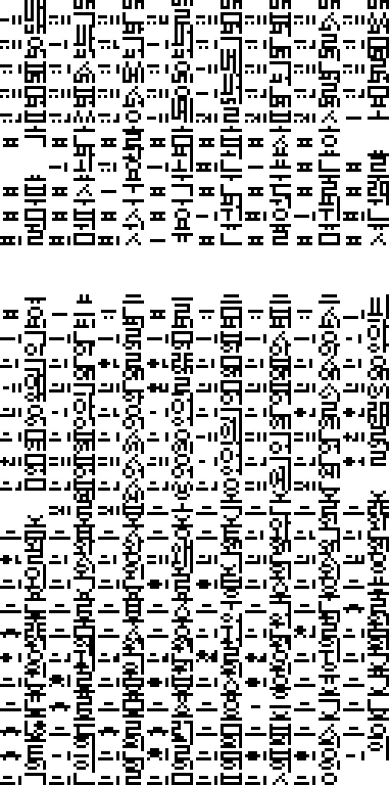 | [`graphics/font/hangul/table-a.png`](graphics/font/hangul/table-a.png) | Unspecified | 512x1024 | `90aaf1ba5d62f278...` |
| 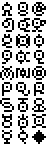 | [`graphics/font/unown-font.png`](graphics/font/unown-font.png) | Unspecified | 48x144 | `5491e2f08b803a18...` |

## Header

| Preview | File | Language | Size | SHA-256 |
| --- | --- | --- | --- | --- |
|  | [`graphics/header/nintendo-logo-ko.png`](graphics/header/nintendo-logo-ko.png) | Korean | 384x64 | `10e9a7189dad4bcc...` |
|  | [`graphics/header/nintendo-logo-en.png`](graphics/header/nintendo-logo-en.png) | English | 384x64 | `10e9a7189dad4bcc...` |
|  | [`graphics/header/nintendo-logo-de.png`](graphics/header/nintendo-logo-de.png) | German | 384x64 | `10e9a7189dad4bcc...` |
|  | [`graphics/header/nintendo-logo-fr.png`](graphics/header/nintendo-logo-fr.png) | French | 384x64 | `10e9a7189dad4bcc...` |
|  | [`graphics/header/nintendo-logo-it.png`](graphics/header/nintendo-logo-it.png) | Italian | 384x64 | `10e9a7189dad4bcc...` |
|  | [`graphics/header/nintendo-logo-es.png`](graphics/header/nintendo-logo-es.png) | Spanish | 384x64 | `10e9a7189dad4bcc...` |
|  | [`graphics/header/nintendo-logo.png`](graphics/header/nintendo-logo.png) | Unspecified | 384x64 | `10e9a7189dad4bcc...` |

## Overworld

| Preview | File | Language | Size | SHA-256 |
| --- | --- | --- | --- | --- |
| 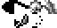 | [`graphics/overworld/effects-atlas.png`](graphics/overworld/effects-atlas.png) | Unspecified | 64x32 | `8a009e1575e696e7...` |
|  | [`graphics/overworld/emotes-atlas.png`](graphics/overworld/emotes-atlas.png) | Unspecified | 128x64 | `1791e3549e249f6d...` |

Metadata sidecars:

- [`graphics/overworld/emotes-effects-atlas.json`](graphics/overworld/emotes-effects-atlas.json) — `da009cdc83cc6ec2...`

## Pokemon

| Preview | File | Language | Size | SHA-256 |
| --- | --- | --- | --- | --- |
| 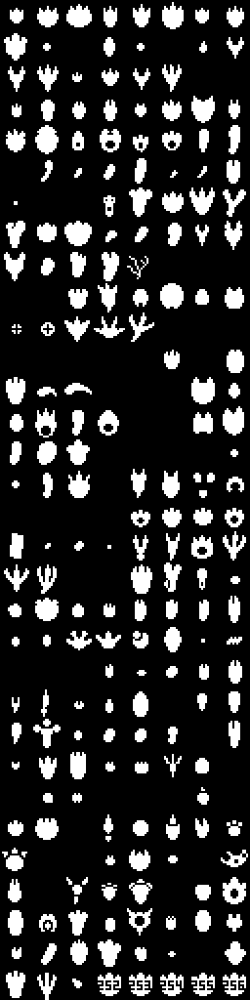 | [`graphics/pokemon/footprints-atlas.png`](graphics/pokemon/footprints-atlas.png) | Unspecified | 256x1024 | `137ad03c5f4befa6...` |
|  | [`graphics/pokemon/party-icons-atlas.png`](graphics/pokemon/party-icons-atlas.png) | Unspecified | 256x320 | `74ada4f53da9ecc3...` |

Metadata sidecars:

- [`graphics/pokemon/footprints-atlas.json`](graphics/pokemon/footprints-atlas.json) — `a5a5d8304af975da...`
- [`graphics/pokemon/party-icons-atlas.json`](graphics/pokemon/party-icons-atlas.json) — `255575a4ed718d4b...`

## Title

| Preview | File | Language | Size | SHA-256 |
| --- | --- | --- | --- | --- |
| 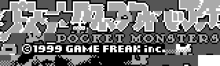 | [`graphics/title/title-logo-jp.png`](graphics/title/title-logo-jp.png) | Japanese | 320x96 | `244d750f41b8e398...` |
| 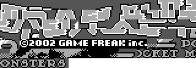 | [`graphics/title/title-logo-ko.png`](graphics/title/title-logo-ko.png) | Korean | 320x112 | `5d34ae712bf7d812...` |
|  | [`graphics/title/title-logo-bottom-en.png`](graphics/title/title-logo-bottom-en.png) | English | 320x96 | `26d2185fa2d4a850...` |
|  | [`graphics/title/title-logo-top-global.png`](graphics/title/title-logo-top-global.png) | Global | 320x48 | `eba68d5af222c245...` |
|  | [`graphics/title/title-logo-bottom-de.png`](graphics/title/title-logo-bottom-de.png) | German | 320x96 | `c28d76d789262ae7...` |
|  | [`graphics/title/title-logo-bottom-fr.png`](graphics/title/title-logo-bottom-fr.png) | French | 320x96 | `e9188ca1389d8b6e...` |
| 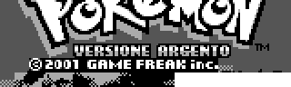 | [`graphics/title/title-logo-bottom-it.png`](graphics/title/title-logo-bottom-it.png) | Italian | 320x96 | `c5075ad5dda609bf...` |
|  | [`graphics/title/title-logo-bottom-es.png`](graphics/title/title-logo-bottom-es.png) | Spanish | 320x96 | `b190cf7c300c052b...` |

Every entry is tied to at least one existing analysis or manifest record. Full hashes and provenance links are in `analysis/public-graphics-catalog.json`.
